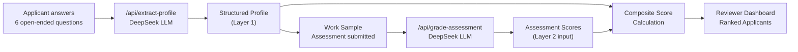
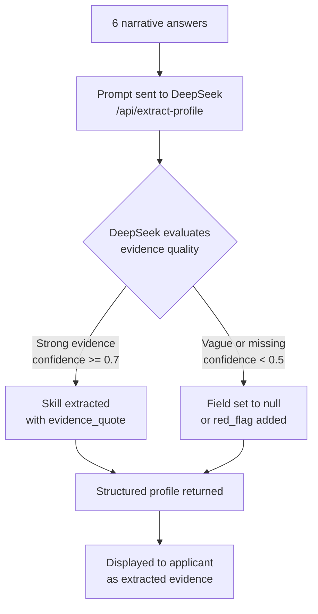
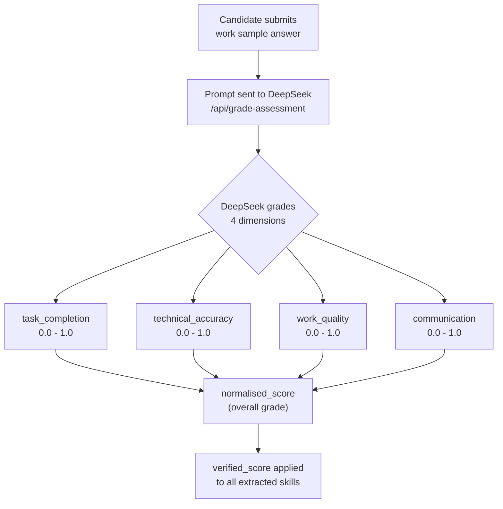
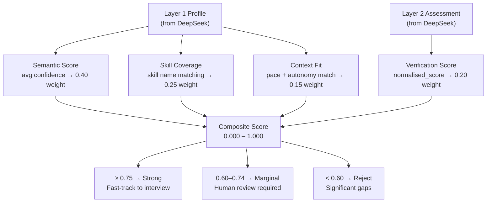

# CareerOS V2 — Scoring Architecture

A full technical reference for how applicant data flows through the AI pipeline, how DeepSeek assesses each input, and how the final composite score is calculated.

---

## Full Pipeline Flow



---

## Layer 1 — Open-Ended Questionnaire & Profile Extraction

### What the applicant sees

Six open-ended narrative questions tailored to the role they selected. Examples for Platform Engineer:

| # | Label | Purpose |
|---|---|---|
| Q1 | Proudest Work | Evidence of real ownership and outcomes |
| Q2 | Technical Complexity | Depth of domain expertise |
| Q3 | Work Environment | Work context preferences |
| Q4 | Career Trajectory | Direction and anti-preferences |
| Q5 | Failure & Learning | Self-awareness and resilience |
| Q6 | Domain Approach | Practical reasoning in the domain |

Each role (HR, Operations Admin, etc.) has its own version of these six questions.

### How DeepSeek assesses the answers (`/api/extract-profile`)

**Model:** `deepseek-chat` · **Temperature:** `0.2` (low, for consistency) · **Response format:** `json_object`

**What the prompt instructs DeepSeek to do:**
- Read all six answers as a single narrative
- Extract only what is **directly evidenced** — no hallucination
- Return verbatim `evidence_quote` from the candidate's actual text
- Assign `confidence` scores based on evidence quality:
  - `0.9+` = strong direct evidence
  - `0.7–0.9` = clear inference
  - `0.5–0.7` = reasonable guess
  - `< 0.5` = return null, do not guess
- Flag `red_flags` for keyword stuffing, vague answers, or inconsistencies
- If answers are nonsensical or single words — return empty `skills`, null context/goals, and a `vague_answers` red flag

**Output schema returned by DeepSeek:**

```json
{
  "skills": [
    {
      "name": "string",
      "evidence_quote": "verbatim quote from candidate answer",
      "inferred_level": "junior | mid | senior | expert",
      "confidence": 0.85
    }
  ],
  "work_context": {
    "preferred_team_size": "string or null",
    "preferred_pace": "exploratory | balanced | execution-focused | null",
    "autonomy_level": "low | medium | high | null"
  },
  "goals": {
    "direction": "string or null",
    "anti_preferences": ["string"]
  },
  "soft_signals": {
    "communication_style": "string or null",
    "decision_making_pattern": "string or null"
  },
  "red_flags": [
    {
      "type": "keyword_stuffing | inconsistency | vague_answers",
      "detail": "string"
    }
  ]
}
```

### Layer 1 extraction flow



---

## Layer 2 — Work Sample Assessment & Grading

### What the applicant sees

A role-specific practical task with:
- A **context** paragraph (scenario setup)
- **3 numbered steps** to complete
- A **data artifact** (code snippet, table, or process data relevant to the role)
- A free-text answer area

Examples:
- **Platform Engineer:** EKS IAM Policy Audit — identify a security flaw in a JSON policy, write a corrected least-privilege policy
- **HR Business Partner:** Employee Retention Analysis — diagnose turnover root causes from eNPS/tenure data, propose a 90-day plan
- **Operations Admin:** Onboarding Process Audit — identify inefficiencies in an 8-team sequential process, propose fixes with owners

### How DeepSeek grades the submission (`/api/grade-assessment`)

**Model:** `deepseek-chat` · **Temperature:** `0.1` (very low, for strict scoring) · **Response format:** `json_object`

**What the prompt instructs DeepSeek to do:**
- Receive the task description and the candidate's free-text answer
- Grade across four dimensions, each `0.0–1.0`
- Be strict — do not inflate scores
- If submission is empty, all scores must be `0.0`

**Grading dimensions:**

| Dimension | What it measures |
|---|---|
| `task_completion` | Did the candidate attempt and complete all required steps? |
| `technical_accuracy` | Is the solution technically / domain-correct? |
| `work_quality` | Depth, structure, and thoughtfulness of the response |
| `communication` | Clarity of reasoning and explanation |
| `normalised_score` | Overall percentile score (0.0–1.0) across all four dimensions |
| `feedback` | One-sentence human-readable summary of the grade |

**Output schema:**

```json
{
  "task_completion": 0.85,
  "technical_accuracy": 0.80,
  "work_quality": 0.78,
  "communication": 0.82,
  "normalised_score": 0.81,
  "feedback": "Candidate correctly identified the flaw and provided a well-reasoned least-privilege policy."
}
```

### Layer 2 grading flow



> **Key design decision:** The `normalised_score` from the work sample is applied as `verified_score` to every skill extracted in Layer 1. This means the work sample directly validates (or invalidates) the narrative claims made in the open-ended questions.

---

## Composite Score Calculation

### Formula

```
Composite = (Semantic × 0.40)
          + (Skill Coverage × 0.25)
          + (Verification × 0.20)
          + (Context Fit × 0.15)
```

### How each factor is derived

#### Semantic Score (40%)
Approximated from the average `confidence` score of all extracted skills:
```
semantic = min(0.99, (avg_confidence × 0.8) + 0.15)
```
Measures how narrative-rich and domain-aligned the candidate's answers were.

#### Skill Coverage (25%)
Proportion of the job's **non-negotiable** required skills found in the candidate's extracted skills profile, using partial word matching:
```
skill_coverage = matched_non_negotiable_skills / total_non_negotiable_skills
```
Matching is fuzzy — e.g. "Employee Relations" matches extracted skill "Employee Relations & Investigation" by keyword overlap.

#### Verification Score (20%)
Directly the `normalised_score` returned by DeepSeek from the work sample assessment:
```
verification = assessment.normalised_score
```
This is the **only independently tested signal** — everything else is self-reported narrative.

#### Context Fit (15%)
Compares the candidate's extracted work preferences against the job's team context:
```
context_fit = matching_context_fields / total_context_fields
```
Fields compared:
- `preferred_pace` vs `team_context.pace`
- `autonomy_level` vs `team_context.autonomy_offered`

### Scoring flow



---

## Score Interpretation for Reviewers

| Composite Range | Decision | Notes |
|---|---|---|
| 0.75 – 1.00 | Proceed to interview | Strong signal across multiple factors |
| 0.60 – 0.74 | Human review required | Check which factor is dragging the score |
| < 0.60 | Likely reject | Significant gaps in skill, context, or evidence quality |

### Red flag combinations

| Pattern | Interpretation |
|---|---|
| High semantic + low verification | Candidate may be keyword-optimising narrative. Prioritise work sample score. |
| High verification + low skill coverage | Strong performer but skills don't map to this specific role. |
| Low context fit | May underperform regardless of skill — probe in interview. |

---

## Weight Adjustment (Layer 3 — Post-Hire Feedback Loop)

After a hire is made and 90-day performance is rated, the model weights can be retrained:

| Outcome | Adjustment |
|---|---|
| High performance (rating ≥ 4) | Verification weight increased to 30% — strong work sample predicts success |
| Poor performance (rating < 4) | Semantic weight increased to 45%, verification reduced — unverified claims were penalised |

This feedback loop allows the scoring model to learn from actual hiring outcomes over time.
